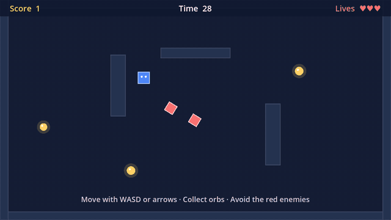
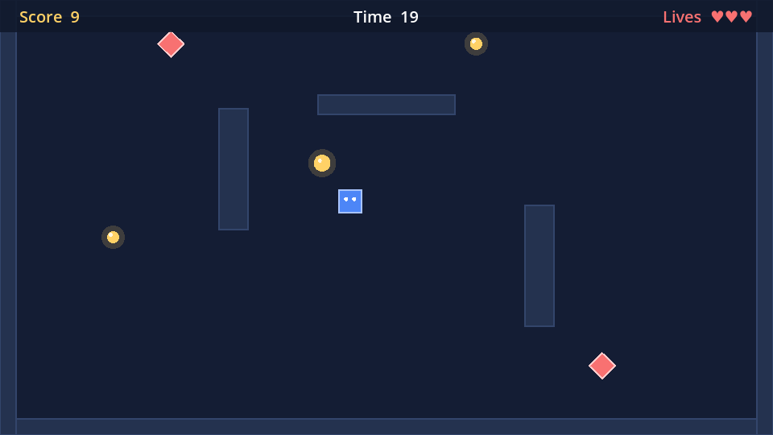
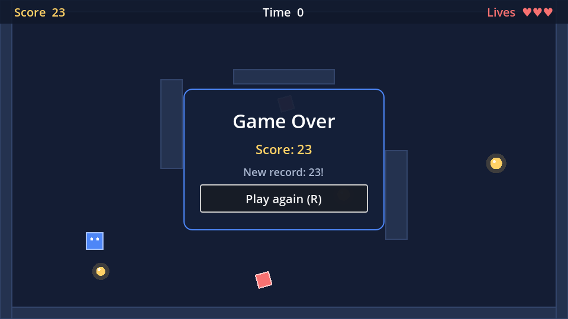

# Orb Runner

[](https://github.com/PabloTosati/godot-csharp-orb-runner/actions/workflows/ci.yml)


A small 2D arcade game made with **Godot 4 and C#**. Collect orbs, avoid the enemies and beat your best score in 30 seconds.

It is a portfolio project that shows clean Godot C# code and the fixes for the bugs that most often break Godot C# games (see [Common Godot C# bugs](#common-godot-c-bugs-and-how-this-project-fixes-them)).



## Features

- **Physics movement** with `CharacterBody2D` and `MoveAndSlide`: walls and pillars really block the player
- **Signals** between scenes: orbs, player hits and the HUD restart button
- **Enemies** that patrol the arena and cost one life per hit, with a short protection time after each hit
- **HUD and game over screen** with score, time, lives, best score and "Play again"
- **Best score saved** to the user folder with `ConfigFile`
- **Pure C# game rules** (`GameState`) separated from the nodes, so they are easy to test
- **24 automated tests** that run inside Godot, headless, on every push

| Playing | Game over |
| --- | --- |
|  |  |

## Controls

| Action | Keys |
| --- | --- |
| Move | WASD or arrow keys |
| Play again | R or Enter |

## Run it

Requirements: [Godot 4.3+ .NET version](https://godotengine.org/download) and the [.NET 8 SDK](https://dotnet.microsoft.com/download).

1. Clone the repository: `git clone https://github.com/PabloTosati/godot-csharp-orb-runner.git`
2. Open Godot, click **Import** and select `project.godot`
3. Press **F5** (Godot builds the C# code the first time)

## Project structure

```
scenes/
  Main.tscn      Arena, walls, player, HUD; spawns orbs and enemies
  Player.tscn    CharacterBody2D
  Orb.tscn       Area2D collectible
  Enemy.tscn     Area2D that patrols
  Wall.tscn      StaticBody2D with an editable size
  Hud.tscn       CanvasLayer with labels and the game over panel
scripts/
  GameState.cs   Score, lives, time and best score (plain C#)
  Main.cs        Round flow and signal wiring
  Player.cs      Movement and hits
  Orb.cs         Collect logic
  Enemy.cs       Patrol and contact damage
  Wall.cs        [Tool] script: shape and drawing follow the Size property
  Hud.cs         UI updates and the restart signal
  SaveData.cs    Best score file
  InputSetup.cs  Input actions created in code
tests/           Test runner scene (runs headless)
tools/           Autopilot that plays by itself (used to record the GIF)
```

Collision layers keep things simple: walls are on layer 1, the player is on layer 2, and orbs and enemies only look for layer 2.

## Common Godot C# bugs (and how this project fixes them)

These are the problems I see most in Godot C# projects. Each one is fixed in this code and covered by a test when possible.

### 1. The player walks through walls

Changing `Position` teleports the body and skips collision checks.

```csharp
// Bug
Position += direction * Speed * (float)delta;

// Fix (Player.cs)
Velocity = direction * Speed;
MoveAndSlide();
```

The test `left wall stops the player` fails if the bug comes back.

### 2. The game runs faster or slower on different PCs

Moving in `_Process` without `delta` ties the speed to the frame rate. Physics movement belongs in `_PhysicsProcess`, where `MoveAndSlide` already uses the physics step. The enemies move manually, so they multiply by `delta` (`Enemy.cs`).

### 3. An item is counted twice

`QueueFree()` only removes the node at the end of the frame, so the collect code can run again before that. A classic cause is the signal being connected twice: once in the editor and once in code. A guard flag makes collecting happen exactly once (`Orb.cs`):

```csharp
if (_collected || body is not Player)
    return;
_collected = true;
SetDeferred(Area2D.PropertyName.Monitoring, false);
EmitSignal(SignalName.Collected, this);
QueueFree();
```

### 4. "Can't change this state while flushing queries"

Adding or removing physics objects inside a physics callback (like `body_entered`) is not allowed. Spawning the next orb is deferred to the end of the frame (`Main.cs`):

```csharp
CallDeferred(MethodName.SpawnOrb);
```

### 5. NullReferenceException from GetNode

Calling `GetNode` in a field initializer or constructor runs before the children exist. Node references are taken in `_Ready` (`Hud.cs`, `Main.cs`).

### 6. "Missing partial modifier" / signals not generated

In Godot 4, every C# class that inherits from a Godot type must be `partial`, so Godot's source generators can add the signal and property code:

```csharp
public partial class Player : CharacterBody2D
```

### 7. Resizing one object resizes all of them

Scenes share their resources. If every wall used the same `RectangleShape2D`, changing one wall's size would change all of them. Each wall creates its own shape (`Wall.cs`). In the editor, the **Local to Scene** option does the same.

### 8. An enemy stops hurting the player

`body_entered` only fires when the body enters. If the player stays inside the enemy after the protection time ends, nothing happens. The enemy checks `GetOverlappingBodies()` every physics frame instead, and the player's protection time prevents losing every life at once (`Enemy.cs`, `Player.cs`).

## Tests

The tests run inside Godot, without a window:

```bash
dotnet build
godot --headless --path . res://tests/TestRunner.tscn
```

| Part | What is checked |
| --- | --- |
| Rules (`GameState`) | Score, lives, countdown, round ending once, best score |
| Real game (`Main.tscn`) | Orbs and enemies spawn, an orb scores exactly once and is replaced, walls and pillars block the player, movement speed, one life per enemy hit, protection after a hit, game over panel, best score saved, restart |

They also run on GitHub Actions on every push. As a check that the tests really catch bugs: replacing `MoveAndSlide()` with `Position +=` makes two of them fail.

## Author

**Pablo Tosati**: I fix bugs and write C# scripts for Godot games, and build Chrome extensions and REST APIs.
[GitHub](https://github.com/PabloTosati) · [Fiverr](https://www.fiverr.com/pablotosati)
